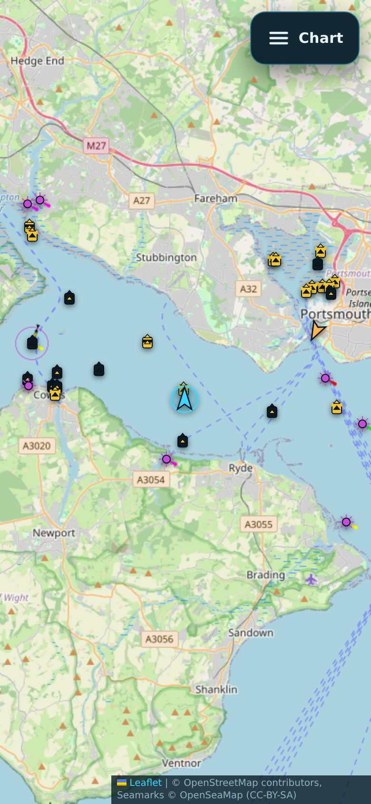

# MARNAV — Marine Navigation

A mobile-first marine navigation chartplotter: a full-screen Leaflet chart, an
offline-capable NAVAID database, live AIS traffic, a searchable COLREGs guide and
wind, wave and tide dashboards. One control (top-right) opens every setting; no
floating docks, zoom stacks or panels appear unless you switch them on.



## Run it

```bash
npm install
npm run dev          # http://localhost:3000
npm run build        # typecheck + production bundle
npm test             # 37 unit tests
```

The dev server needs Node (the AIS relay is a WebSocket server). Static hosting
alone cannot run `/ws/ais` or `/api/overpass`.

### Environment

`AISSTREAM_API_KEY` belongs in `.env.local` (git-ignored) and is read only by
the server process:

```
AISSTREAM_API_KEY=your-key-here
```

The browser never receives the key: it opens `/ws/ais`, and the server holds the
upstream AISStream connection. Without a key the relay serves clearly-labelled
**simulated** traffic so the station still works offline.

## What is in the chart

**Base charts**

- OpenStreetMap standard raster
- Esri World Imagery satellite
- **NOAA ENC** — rendered from NOAA ENC Direct (`encdirect/enc_harbour`,
  `enc_coastal`, `enc_general` by zoom). US waters only; outside coverage the
  menu explains the limitation and no tiles are requested.

**Overlays** (each independently toggleable, all in the menu)

- OpenSeaMap seamark raster (transparent over any base)
- NAVAIDs from the local database
- Ferry routes (132 charted routes, Solent + New York)
- TSS lanes (separation lanes, zones, boundaries and lines, Dover Strait and
  Solent approaches)
- AIS targets

**NAVAIDs**

- Tap/hover a mark for quick info, tap again for the full reference sheet
  (category, position, light character, colour, topmark, height, nominal range,
  source, OSM reference).
- IALA Region A/B symbol colours are chosen from the mark's position.
- Zoom declutter hides minor marks until they are useful; **Show all marks**
  overrides it, and the menu always reports `shown of total` so nothing is
  silently dropped.

## NAVAID database

`npm run db:build` reads the raw Overpass snapshots in `data-raw/`, classifies
every seamark, merges duplicates and writes:

- `public/navaid-db/manifest.json` — version, regions, shard index, sources, stats
- `public/navaid-db/<region>/*.json` — per-cell shards (250 KB → 1 MB total)
- `src/data/solentNavaids.json` — 400-aid seed for instant first paint

Current build: **3,256 unique aids** from 3,693 raw records, **248 duplicates
merged**, two regions (Solent & Isle of Wight, New York Harbor), 21 shards.

Ingest, classification, dedupe and declutter all live in `shared/navaid-core.mjs`
and are imported by the app, the tests *and* the builder, so the database and the
chart can never disagree about what a mark is.

On the device:

- shards and the manifest are cached in IndexedDB keyed by database version;
- the manifest is revalidated with `cache: 'no-store'` once a week
  (`shouldRevalidate`), and a new version drops the old shards;
- **Check for updates** in the menu forces the check;
- a pan into an area with no built shards falls back to the live Overpass proxy.

### Sources

`src/data/navaidSources.json` audits 16 chart sources (OpenCPN's list, C-MAP,
gpsnauticalcharts, i-Boating, UKHO, NOAA, BSH, LINZ, CHS and others) with
licence and redistribution terms. Only two can legitimately feed a bundled
database: **OpenStreetMap seamarks** (ODbL, used) and **NOAA ENC Direct**
(public domain, configured). The commercial suites have no public endpoints and
cannot be redistributed; their entries record why.

## Stations

- **AIS** — live vessels from AISStream through the relay: name, MMSI, type,
  distance, SOG, COG, age. The relay reconnects with exponential backoff and
  keeps the last snapshot on screen while it does. Simulated mode is labelled.
- **COLREGs** — 40 offline entries across Parts A–E plus annexes, searchable by
  rule number, title, keyword or part, with regional modifications for the
  **US** (Inland Rules, 33 CFR 83/84), **Canada** (TP 14202) and **Europe**
  (CEVNI, IALA A). Summaries only, with links to the official texts.
- **Weather & tides** — Open-Meteo wind, gusts, wave height/period, sea and air
  temperature for the chart position or GPS fix, plus the next four NOAA tide
  events for the nearest station within 350 km.

## Vessel position

GPS is a persisted binary setting:

- **Always on** — a single `watchPosition` runs for the chart's lifetime; SOG and
  heading are derived from consecutive fixes when the device does not report them.
- **Always off** — the watch is never opened, the fix is cleared, and the panel
  explains that nothing is being requested.

The position panel is opt-in from the menu and shows coordinates, SOG, COG,
accuracy and a compass rose. Turning off GPS from the menu also clears the
on-chart vessel marker. `marnav:gps-mode` in `localStorage` remembers the choice.

## Deep links

`/?lat=40.70&lon=-74.03&z=13` opens the chart at a position and zoom — useful for
sharing a spot or reproducing a report.

## Verification

```bash
npm run typecheck
npm test
npm run build
node scripts/verify-data.mjs                     # manifest, shards, seed, lanes
npx playwright install chromium                  # once
node scripts/verify-ui.mjs                       # 36 browser checks + screenshots
node scripts/ais-probe.mjs 20                    # AISStream connectivity
```

`verify-ui.mjs` covers phone (390×844), tablet (820×1180), landscape phone and a
US/NOAA context: full-viewport chart, no horizontal overflow, ≥44 px controls,
single menu sections, NAVAID hover + reference sheet, GPS panel, live AIS,
COLREGs search, weather/tides, NOAA coverage guard, real NOAA raster content, and
the right-hand tablet panel. Screenshots land in `artifacts/`.

On a minimal Linux container, headless Chromium may need `libnss3`, `libnspr4`,
`libatk*`, `libx*` and fonts. This VM runs it with extracted `.deb` libraries via
`LD_LIBRARY_PATH` and a fontconfig override; a normal desktop install does not
need that.

## Limitations

- **OSM is the only worldwide, queryable, redistributable AtoN source.** Coverage
  is thin in some regions, and some features (e.g. `range_marker`) have no OSM
  tagging convention at all, so those marks can only appear where they are mapped.
- **NOAA ENC bands cover ports and approaches**, not every square mile. Blank
  chart paper means that band has no tile there; switch bands by zooming. NOAA is
  US-only and its export service is slow (roughly a second per tile).
- **AISStream** drops upstream connections by design; the relay reconnects and the
  panel shows "Reconnecting". Vessel names and types arrive in separate static
  messages, so a fresh session shows some unnamed targets.
- **Tides** use NOAA predictions only; outside 350 km of a NOAA station the panel
  says so rather than inventing a curve.
- **The COLREGs view is a study aid**, not the legal text. Check the official
  convention, national modifications and local notices to mariners.
- The AIS key in `.env.local` should be rotated before any public deployment.

## Attribution

Map data © OpenStreetMap contributors (ODbL). Seamark overlay © OpenSeaMap
(CC-BY-SA). Imagery © Esri, Maxar, Earthstar Geographics. Charts and tide data ©
NOAA (public domain). Forecasts from Open-Meteo. AIS data via AISStream.
